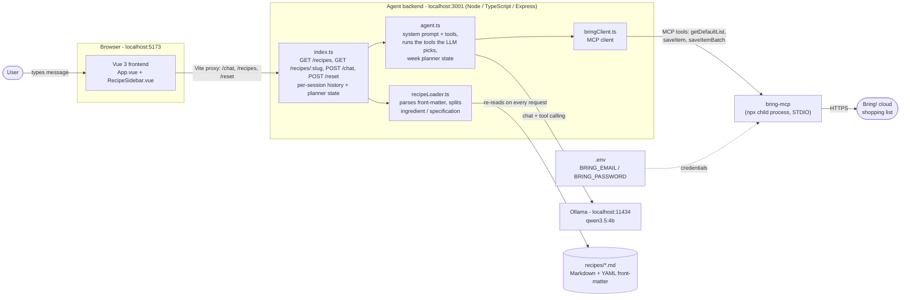

# Bring! AI Agent

A local AI assistant that reads recipes from Markdown files and adds the ingredients straight to your [Bring!](https://www.getbring.com/) shopping list. You chat with the agent in German or English. Everything except Bring! itself runs on your machine: the LLM runs locally via Ollama, and no API keys are needed.

Access to Bring! is provided by the open-source [`bring-mcp`](https://github.com/florianwittkamp/bring-mcp) MCP server by Florian Wittkamp.

## Architecture



### How a request flows

The LLM always decides what to do. It uses Ollama **tool calling**, and the server then executes the chosen tool.

1. The frontend sends `POST /chat` with the message and a random per-tab `sessionId`. The Vite dev server proxies this to the backend.
2. `agent.ts` sends the message, the history (last 20 messages) and a system prompt to Ollama, together with six tool definitions. The prompt lists **only the available recipes** and the pending week plan, if there is one.
3. The model answers with a tool call. The server executes it and shows you the real result, never the model's own claim:

   | Tool | Use case |
   |---|---|
   | `propose_week_plan` | "Plan my week" / "pick 5 recipes". The server picks them randomly, stores them as `pending` and **asks for confirmation**. Nothing is added yet. |
   | `confirm_week_plan` | You say "yes". The ingredients of all pending recipes go to Bring!. |
   | `swap_recipe_in_plan` / `cancel_week_plan` | Replace one recipe in the proposal, or discard it. |
   | `add_recipe_to_list` | "Add the ingredients for Pfannkuchen". The ingredients come from the recipe file, so the LLM cannot invent any. |
   | `add_items_to_list` | "2 Äpfel und 3 Bananen". The model splits this into name and amount. |

4. `bringClient.ts` starts `npx bring-mcp@latest` as a child process (once, lazily). It looks up your list by name with `loadLists` (default **Einkauf Supermarkt**, see `BRING_LIST_NAME`) and writes with `saveItemBatch`.

**Where is the prompt?** In [`server/src/agent.ts`](server/src/agent.ts), in `buildSystemPrompt()`. The tool descriptions are in the `tools` array just below it.

## Prerequisites

- **Node.js** 22+
- **Ollama** installed. Pull the model with `ollama pull qwen3.5:4b` (`start.sh` does this automatically on first run).
- A **Bring! account** with email and password (Google/Apple-only logins do not work).

## Setup

1. Copy `.env.example` to `.env` (`cp .env.example .env`) and enter your Bring! credentials. `.env` is listed in `.gitignore`, so it is never committed.
   ```
   BRING_EMAIL=your@email.com
   BRING_PASSWORD=yourPassword
   ```

2. Install dependencies:
   ```bash
   npm install                    # bring-app root (MCP smoke test)
   cd server && npm install       # agent backend
   cd ../frontend && npm install  # Vue frontend
   ```

## Running

### Quick start (everything at once)
```bash
./start.sh
```
The script checks that Ollama is installed, pulls the model if it is missing, starts `ollama serve` only if it is not already running, then starts the backend and the frontend. Ctrl+C stops everything.

### Manually in three terminals

**Terminal 1 — Ollama** (skip if it already runs as a service):
```bash
ollama serve
```

**Terminal 2 — agent backend** (port 3001):
```bash
cd server && npm run dev
```

**Terminal 3 — Vue frontend** (port 5173):
```bash
cd frontend && npm run dev
```

Then open **http://localhost:5173**.

## Usage

| What you say | What happens |
|---|---|
| `Plane meine Woche` / `Plan my week` | Agent picks 7 random recipes and asks for confirmation |
| `Ja` / `Bestätigt` / `Yes` | All ingredients of the plan land in Bring! |
| `Ersetze Linsensuppe durch Pfannkuchen` | Swaps a recipe in the proposal |
| `Nein` / `Abbruch` | Discards the proposal |
| `Füge Zutaten für Spaghetti Bolognese hinzu` | Adds that recipe's ingredients directly |
| `2 Äpfel und 3 Bananen` | Adds these items with their amounts |
| Click 🛒 in the sidebar | Adds that recipe's ingredients to the list |
| `↺ Neu` button | Clears the chat history and any pending plan |

## Adding recipes

Create a new `.md` file in `recipes/` using this format. The recipes are in German and the ingredients are sent to Bring! as-is, so keep them in German.

```yaml
---
title: My Recipe
servings: 4
ingredients:
  - Ingredient1
  - Ingredient2
ingredientDetails:        # optional: amounts, sent as Bring! "specification"
  Ingredient1: "200g"
  Ingredient2: "2 Stück"
---

## Zubereitung
...
```

- `ingredients` holds the item names that appear on the Bring! list.
- `ingredientDetails` maps an ingredient to its amount. If an entry is missing, the loader tries to split a leading amount from strings like `400g Spaghetti`.
- The agent only knows these files and will not invent recipes.
- New recipes are picked up automatically: the backend re-reads `recipes/` on every request. The sidebar refreshes when you click ↻ or return to the browser tab; the agent sees new files on its next message. No restart needed.
- Click a recipe in the sidebar to see its ingredients with amounts and the full instructions (the Markdown body after the front-matter).

## Smoke test for the Bring! connection

```bash
node test-mcp.mjs --keep    # adds "Äpfel" to the list and leaves it there
node test-mcp.mjs           # adds it, waits 3 s, then removes it again
```

## Project structure

```
bring-app/
├── .env                     # Bring! credentials (do not commit)
├── .env.example             # template for .env
├── start.sh                 # starts Ollama, backend and frontend together
├── test-mcp.mjs             # standalone smoke test for bring-mcp
├── package.json             # root deps (MCP SDK, used by test-mcp.mjs only)
├── recipes/                 # 9 German recipes (Markdown + YAML front-matter)
├── server/                  # agent backend (Node + TypeScript, run with tsx)
│   └── src/
│       ├── index.ts         # Express app: /recipes, /chat, /reset, session store
│       ├── agent.ts         # system prompt, tool definitions, Ollama call, tool execution, week planner
│       ├── bringClient.ts   # MCP client wrapper around bring-mcp (STDIO), finds the target list by name
│       └── recipeLoader.ts  # reads recipes/*.md, builds {name, specification} items
├── frontend/                # Vue 3 + Vite
│   ├── vite.config.ts       # dev server on 5173, proxies API routes to 3001
│   └── src/
│       ├── main.ts
│       ├── App.vue          # chat UI (messages, input, reset)
│       └── components/
│           └── RecipeSidebar.vue  # recipe list, clickable recipe detail modal, "add to Bring!" button
└── bob_artifacts/           # planning documents (implementation plan, ideas)
```

### Backend API

| Endpoint | Description |
|---|---|
| `GET /recipes` | Returns `[{ slug, title, servings }]`, re-read from disk on every call |
| `GET /recipes/:slug` | Returns `{ slug, title, servings, ingredients: [{ name, specification }], instructions }` or 404 |
| `POST /chat` | Body `{ message, sessionId? }`, returns `{ reply }` |
| `POST /reset` | Body `{ sessionId? }`, clears the session's history and pending plan |

### Configuration

| Variable | Default | Purpose |
|---|---|---|
| `BRING_EMAIL`, `BRING_PASSWORD` | none (required) | Bring! login, passed to `bring-mcp` |
| `BRING_LIST_NAME` | `Einkauf Supermarkt` | Name of the Bring! list that receives items (see the list names in the Bring! app) |
| `OLLAMA_MODEL` | `qwen3.5:4b` | Model used for chat (must support tool calling) |
| `PORT` | `3001` | Backend port. If you change it, update the proxy in `frontend/vite.config.ts` too. |

## Troubleshooting

- **`EADDRINUSE` on port 3001 or 5173**: another instance is already running. Stop it first (`lsof -i :3001`, then `kill <pid>`).
- **First request is slow**: the first request starts `bring-mcp` through `npx` and logs in to Bring!, and Ollama loads the model.
- **The LLM picks the wrong tool or none**: a 4B model is not perfect. The `🧠` line in the backend log shows exactly which tool and arguments it chose. Rephrase, or tune the prompt in `buildSystemPrompt()`.
- **`Bring! list "..." not found`**: set `BRING_LIST_NAME` in `.env` to the exact list name. The error message lists your available lists.

## Acknowledgements

- [`bring-mcp`](https://github.com/florianwittkamp/bring-mcp) by [Florian Wittkamp](https://github.com/florianwittkamp): the MCP server this app uses to talk to Bring! (started on demand via `npx bring-mcp@latest`). Check its repository for its own license and documentation.
- [Ollama](https://ollama.com/) for running the LLM locally, and [Bring!](https://www.getbring.com/) for the shopping list service. This project is not affiliated with or endorsed by Bring!.
